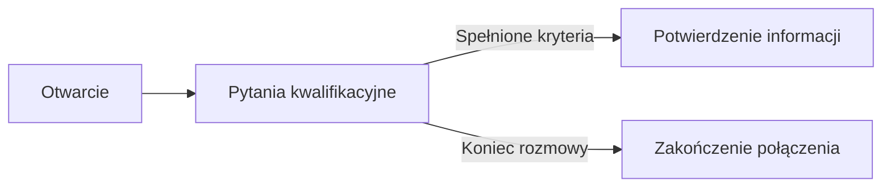
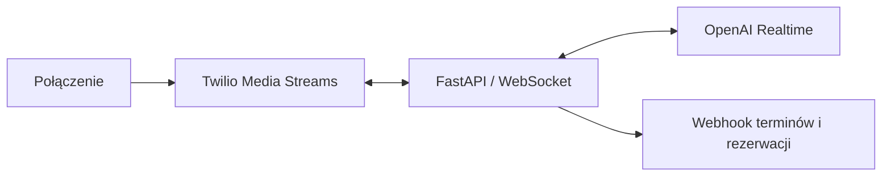

# Voicebot AI — kwalifikacja leadów po rozmowie

Case study of AI voice calls for first-contact sales lead qualification.

**Zakres publiczny:** studium przypadku na podstawie konfiguracji rozmów wychodzących oraz fragment kodu odrębnego prototypu obsługującego rozmowy przychodzące.

## Problem

Voicebot automatyzuje pierwszy telefon sprzedażowy. Rozmawia z potencjalnym klientem, sprawdza zainteresowanie i kwalifikuje lead, żeby handlowiec mógł przejąć zainteresowane kontakty.

## Rozmowy wychodzące

W scenariuszu dla branży OZE rozmowa jest podzielona na wejście, pytania kwalifikacyjne oraz zebranie i potwierdzenie informacji przy pozytywnym wyniku. Odpowiedzi wpływają na ścieżkę. Scenariusz przewiduje zakończenie rozmowy po niespełnieniu kryterium oraz wywołanie narzędzia kończącego połączenie.

Dwie konfiguracje głosowe z branży usług marketingowych wskazują Vapi jako miejsce konfiguracji i dołączoną bazę wiedzy. Rozdzielają informacje o ofercie od zasad wypowiedzi: godzinę spotkania, datę, kwotę, numer kontaktowy i skróty branżowe agent ma wypowiadać w formie naturalnej po polsku. Wspólne reguły wymowy pozwalają przenosić schemat rozmowy pomiędzy markami.



## Prototyp rozmów przychodzących

W odnalezionym prototypie Twilio obsługuje połączenie przychodzące, a FastAPI zwraca instrukcję TwiML połączenia z serwerem WebSocket. Serwer przekazuje audio między Twilio Media Streams i OpenAI Realtime. Znaczniki odtworzenia pomagają koordynować kolejkę odpowiedzi głosowych. Osobne funkcje pytają o terminy i rezerwują spotkanie przez webhook. Równoległy prototyp używa WebRTC w przeglądarce.



## Konfigurowanie agentów w n8n

Trzy zachowane eksporty pokazują automatyzację przygotowania instancji dla różnych scenariuszy. n8n wywołuje API Vapi, tworzy narzędzia, pobiera ich listę, przekazuje identyfikatory do konfiguracji asystenta i wiąże telefon z przygotowaną konfiguracją. Jeden zapisany eksport asystenta zawiera OpenAI jako dostawcę modelu, Deepgram jako transkrypcję i ElevenLabs jako syntezę głosu.

[Mapa przepływu](workflows/vapi-provisioning.md) pokazuje etapy i granicę między konfiguracją instancji a realizacją kampanii.

## Co można sprawdzić

W `voicebot/media_marks.py` znajduje się funkcja z prototypu, która wysyła znacznik strumienia i po udanym zapisie dodaje go do lokalnej kolejki. Testy wykorzystują atrapę połączenia i działają offline.

```bash
python -m unittest discover -s tests
```

Materiały źródłowe potwierdzają scenariusze i konfiguracje agentów, narzędzi i numerów. Harmonogram kampanii, wykonanie połączeń na liście kontaktów, operator telefonii tej kampanii oraz wyniki wymagają osobnego potwierdzenia.
