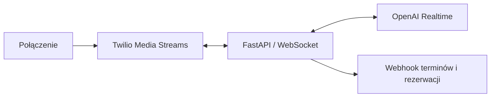

# Voicebot AI — kwalifikacja leadów po rozmowie

Case study of AI voice calls for first-contact sales lead qualification.

**Zakres publiczny:** opis kampanii wychodzącej na podstawie relacji autora oraz wydzielony fragment kodu pokrewnego prototypu OZE.

## Problem

Voicebot automatyzuje pierwszy telefon sprzedażowy. Rozmawia z potencjalnym klientem, sprawdza zainteresowanie i kwalifikuje lead, żeby handlowiec mógł przejąć zainteresowane kontakty.

## Jak działa projekt

1. Automatyzacja uruchamia rozmowę wychodzącą ze wskazanym kontaktem.
2. Agent głosowy prowadzi rozmowę i zadaje pytania, które pomagają rozpoznać zainteresowanie.
3. Wynik kwalifikacji jest podstawą do przekazania kontaktu do kolejnego kroku sprzedaży.
4. Zespół może skoncentrować ręczną pracę na kontaktach wymagających przejęcia.

## Prototyp OZE

W odnalezionym prototypie Twilio obsługuje połączenie przychodzące, a FastAPI zwraca instrukcję TwiML połączenia z serwerem WebSocket. Serwer przekazuje audio między Twilio Media Streams i OpenAI Realtime. Znaczniki odtworzenia pomagają koordynować kolejkę odpowiedzi głosowych. Osobne funkcje pytają o terminy i rezerwują spotkanie przez webhook. Równoległy prototyp używa WebRTC w przeglądarce.



## Co można sprawdzić

W `voicebot/media_marks.py` znajduje się funkcja z prototypu, która wysyła znacznik strumienia i po udanym zapisie dodaje go do lokalnej kolejki. Testy wykorzystują atrapę połączenia i działają offline.

```bash
python -m unittest discover -s tests
```

Dokładny dostawca telefonii, eksport workflow i wyniki kampanii wychodzącej pozostają niepotwierdzone. Opis prototypu dotyczy kodu obsługi połączeń przychodzących.
